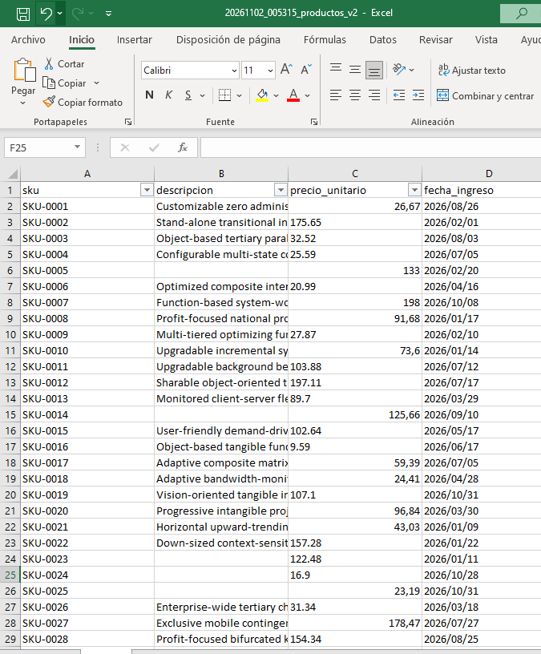
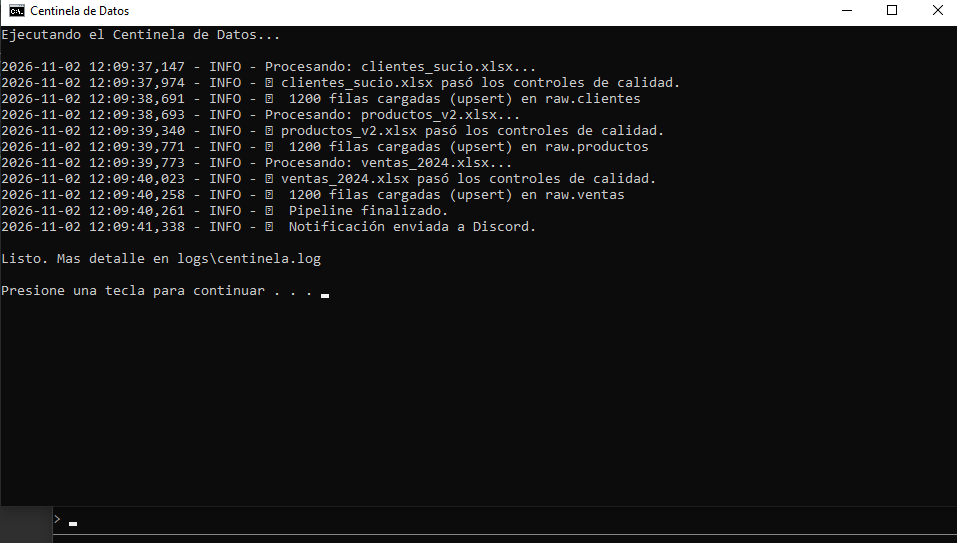
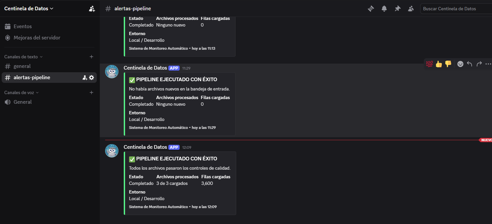
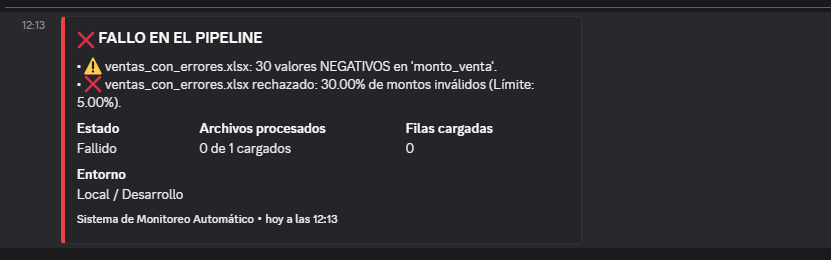
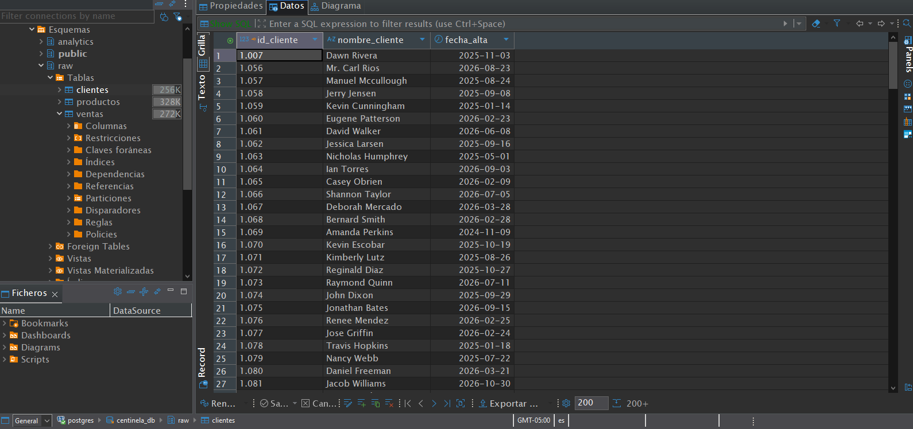
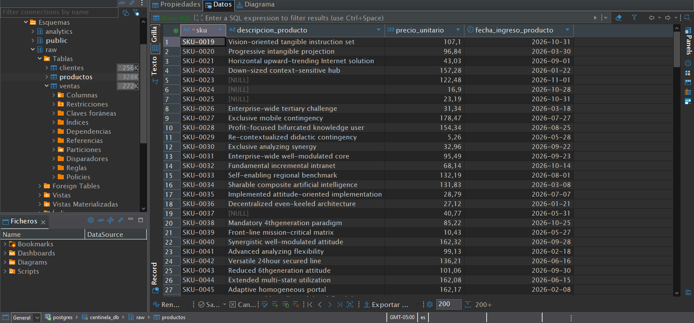
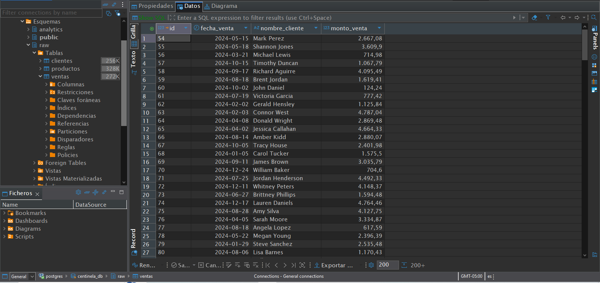
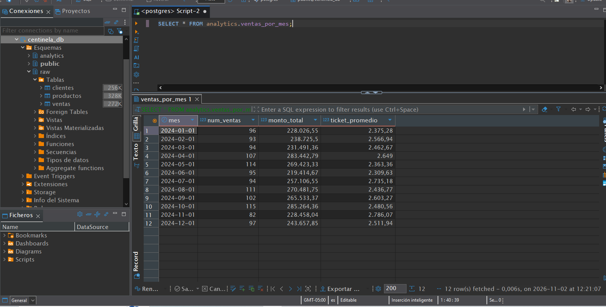
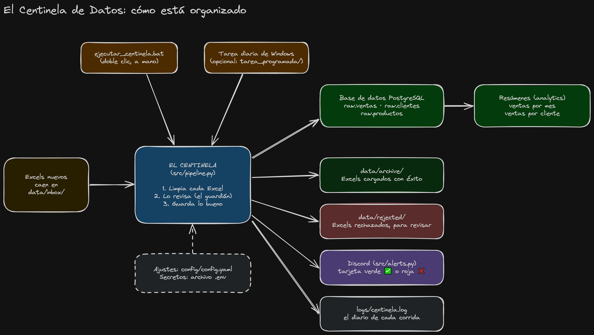

# 🛡️ El Centinela de Datos

## ¿De qué trata este proyecto?

Imagina que tu empresa recibe todos los días listas de ventas, clientes y productos en archivos de Excel. Esos archivos casi nunca vienen limpios:

- las fechas están escritas de formas distintas (`15/03/2024`, `2024-03-15`...),
- los nombres traen espacios de más,
- cada archivo llama diferente a lo mismo ("cliente", "Nombre Completo"...),
- a veces hay montos negativos o filas repetidas por error.

Si guardas todo eso así, los reportes salen mal y nadie confía en los números.

**El Centinela de Datos** es un vigilante automático: lee esos Excels, los limpia, revisa que estén bien, **rechaza o aparta lo que está mal**, y guarda lo bueno en una base de datos ordenada.

## ¿Para qué se hizo?

Es un proyecto de portafolio para practicar y demostrar cómo trabaja un **Ingeniero de Datos**: tomar datos desordenados y entregarlos limpios y confiables para que otras personas puedan analizarlos.

## ¿Qué hace, paso a paso?

1. **Tiene una bandeja de entrada.** Dejas los Excels nuevos en la carpeta `data/inbox/` y el Centinela solo trabaja con lo que haya ahí. Para practicar, puede generar 3 Excels "sucios" a propósito (ventas, clientes, productos).
2. **Los lee y los limpia.** Pone los mismos nombres de columnas en todos, quita espacios sobrantes y arregla las fechas.
3. **Los revisa (el "guardián").**
   - Si un archivo tiene demasiadas fechas rotas, lo rechaza completo.
   - Si hay montos negativos, aparta esas filas y deja pasar el resto.
   - Si hay códigos repetidos, se queda con el primero y aparta los demás.
   - Si hay demasiados problemas de este tipo, rechaza el archivo completo.
   - Si faltan columnas obligatorias, rechaza el archivo con un mensaje claro.
4. **Guarda lo bueno** en una base de datos (PostgreSQL), en tablas con reglas que impiden meter datos absurdos. Los datos nuevos se **suman** a los anteriores; si llega una fila que ya existía, se actualiza en vez de duplicarse.
5. **Ordena los archivos.** Los que se cargaron bien pasan a la carpeta `archive/`; los que se rechazaron, a `rejected/` para que alguien los revise. Así nunca se procesa dos veces el mismo archivo.
6. **Lo apunta todo en un diario** (`logs/centinela.log`): qué se procesó, qué se rechazó y por qué.
7. **Prepara resúmenes listos para usar.** Por ejemplo, "cuánto se vendió cada mes" y "cuánto compró cada cliente", para que nadie tenga que hacer las cuentas a mano.
8. **Te avisa del resultado.** Al terminar manda una tarjeta a un canal de Discord (si lo configuras; es opcional): **verde** si todo salió bien, **roja** si algo falló.
9. **Puede ejecutarse solo (opcional).** Si lo activas, Windows lo lanza todos los días a la hora que elijas (por defecto, 7:00). **Viene apagado**: tú decides si lo quieres y puedes desactivarlo cuando quieras (ver [Ejecución diaria automática](#ejecución-diaria-automática-opcional)).

## Cómo se ve en acción

> Todas las capturas usan datos de práctica generados con `src/generate_data.py`, no datos reales.

### 1. El problema: un Excel sucio
Fechas escritas de formas distintas, espacios de más y montos negativos. Así llegan los archivos.



### 2. El Centinela trabajando
Al ejecutar `ejecutar_centinela.bat` revisa la bandeja, limpia cada archivo, lo valida y lo carga. Ejemplo real de lo que queda en el diario (`logs/centinela.log`):

```
Procesando: clientes_sucio.xlsx...
✅ clientes_sucio.xlsx pasó los controles de calidad.
💾 1200 filas cargadas (upsert) en raw.clientes
Procesando: productos_v2.xlsx...
✅ productos_v2.xlsx pasó los controles de calidad.
💾 1200 filas cargadas (upsert) en raw.productos
Procesando: ventas_2024.xlsx...
✅ ventas_2024.xlsx pasó los controles de calidad.
💾 1200 filas cargadas (upsert) en raw.ventas
🏁 Pipeline finalizado.
📣 Notificación enviada a Discord.
```



### 3. El aviso en Discord
**Verde** cuando todo salió bien:



**Roja** cuando algo falló, con el motivo:



### 4. Los datos limpios en la base de datos
Las tablas `raw.ventas`, `raw.clientes` y `raw.productos` en PostgreSQL, ya sin errores.

**Clientes** (`raw.clientes`):



**Productos** (`raw.productos`):



**Ventas** (`raw.ventas`):



### 5. Los resúmenes listos para reportes
Las vistas `analytics.ventas_por_mes` y `analytics.ventas_por_cliente`.



---

## ¿Quién lo usa y qué valor aporta?

### Para una gerencia o un área que no programa
Nadie del área tiene que abrir código ni una terminal. Su trabajo se reduce a **dejar el Excel en una carpeta** y **mirar un canal de Discord**.

- **Números en los que se puede confiar.** Los reportes dejan de depender de que alguien "limpie el Excel a mano" y de que lo haga igual cada vez. Las reglas son las mismas todos los días.
- **Menos horas en trabajo repetitivo.** Unificar nombres de columnas, arreglar fechas y buscar duplicados es trabajo manual y propenso a errores. Aquí ocurre solo (a la hora programada, si se activa la ejecución diaria).
- **Los problemas se enteran antes de llegar al reporte.** Si un archivo viene mal (montos negativos, ids repetidos, fechas rotas), llega una tarjeta **roja** a Discord diciendo cuál y por qué. Una tarjeta **verde** significa que todo entró bien.
- **Nada se pierde ni se pisa.** El archivo malo se aparta para revisarlo y el bueno queda archivado con fecha. Se puede auditar qué entró y cuándo.
- **Resúmenes listos.** Ventas por mes y compras por cliente ya vienen calculadas para conectarlas a Excel, Power BI u otra herramienta de reportes.
- **Qué se necesita de la gente:** respetar el nombre del archivo (que contenga `ventas`, `clientes` o `productos`) y corregir lo que aparezca en `rejected/` cuando llegue una alerta roja.

**Qué no hace:** no corrige datos de negocio por su cuenta (si un monto es negativo, lo aparta, no lo adivina), y no recibe los archivos solo: alguien o algún proceso debe depositarlos en la bandeja.

### Para un equipo técnico
- **Idempotente:** cargar dos veces el mismo archivo no duplica filas (upsert por clave primaria, en una transacción con rollback).
- **Quality gate configurable:** umbrales en `config/config.yaml` (`quality.*`). Rechazo total del archivo o cuarentena solo de las filas malas, según el porcentaje.
- **Restricciones en la base de datos** (`CHECK`, `NOT NULL`, claves primarias): una segunda línea de defensa si el código falla.
- **Observabilidad:** log con rotación en `logs/centinela.log` y una tarjeta de Discord por corrida. Los números salen de la corrida real.
- **Secretos fuera del código:** usuario, contraseña y webhook van en `.env`, que no se sube a git.
- **Pruebas:** `pytest tests -v` cubre el guardián, la bandeja, las alertas y los casos borde de limpieza.
- **Extensión:** para un tipo nuevo de archivo se agrega una entrada en `TABLE_RULES` (`src/pipeline.py`) y su tabla en `src/schema.py`.
- **Ejecución:** opcional. `tarea_programada/` crea/apaga una tarea del Programador de Windows (a diario, a la hora configurada); corre solo si hay sesión iniciada y, si el PC estaba apagado, al encenderlo. En un servidor se puede migrar a cron o a un orquestador sin cambiar la lógica.

## ¿Cómo está organizado?

El recorrido completo de un Excel, de la bandeja de entrada a la base de datos, las alertas y el diario:



> El dibujo se puede editar abriendo `docs/img/estructura_proyecto.excalidraw` en [excalidraw.com](https://excalidraw.com).

Y así están ordenadas las carpetas y archivos:

```
Centinela_de_Datos/
├── data/                 Los Excels, ordenados según su etapa
│   ├── inbox/            Bandeja de entrada (aquí se dejan los Excels nuevos)
│   ├── archive/          Excels ya cargados con éxito
│   └── rejected/         Excels rechazados (se crea sola cuando hace falta)
├── src/                  El programa
│   ├── pipeline.py
│   ├── schema.py
│   ├── analytics.py
│   ├── alerts.py
│   ├── logger_config.py
│   └── generate_data.py
├── config/config.yaml    Los ajustes
├── ejecutar_centinela.bat  Doble clic para ejecutar el Centinela ahora
├── tarea_programada/     Dobles clics para activar/desactivar la ejecución diaria
├── tests/                Pruebas automáticas
├── docs/                 Explicaciones por fase
├── logs/centinela.log    El diario de lo que pasó
├── Avatar_Discord/       Imagen del bot de Discord
├── .env                  Contraseñas (secreto)
├── .env.example          Plantilla para crear el .env
├── requirements.txt      Lista de piezas que el programa necesita
└── README.md             Este documento
```

### Qué hace cada cosa (sin tecnicismos)

**Las carpetas de datos**

| Carpeta | Para qué sirve |
|---|---|
| `data/inbox/` | **La bandeja de entrada.** Lo único que tú tocas a diario: dejas aquí los Excels nuevos y el Centinela solo mira esta carpeta |
| `data/archive/` | El archivo histórico. Cada Excel cargado con éxito se guarda aquí con la fecha y la hora delante, por si hay que revisar qué entró |
| `data/rejected/` | La carpeta de "revisar a mano". Cada Excel que no pasó los controles queda aquí. Corrígelo y devuélvelo a la bandeja |

**El programa (`src/`)**

| Archivo | Qué hace, en palabras simples |
|---|---|
| `pipeline.py` | **El jefe de la operación.** Revisa la bandeja, limpia cada Excel, lo revisa, lo guarda y lo manda a la carpeta que corresponde. Este es el archivo que se ejecuta |
| `schema.py` | **El plano de la base de datos.** Define cómo son las tablas y sus reglas (por ejemplo, que un monto no pueda ser negativo). Es la última línea de defensa |
| `analytics.py` | **El que prepara los resúmenes.** Crea las tablas de "ventas por mes" y "compras por cliente" para que nadie haga las cuentas a mano |
| `alerts.py` | **El mensajero.** Arma la tarjeta verde o roja y la envía a Discord al terminar |
| `logger_config.py` | **El que lleva el diario.** Decide cómo y dónde se escribe `logs/centinela.log` |
| `generate_data.py` | **El generador de ejemplos.** Crea 3 Excels sucios a propósito para practicar. No se usa con datos reales |

**Los ajustes, el diario y las claves**

| Archivo | Para qué sirve |
|---|---|
| `config/config.yaml` | Los ajustes que sí puedes cambiar: nombres de carpetas, el porcentaje de errores tolerado antes de rechazar un archivo y si se avisa también cuando todo sale bien. **No tiene contraseñas** |
| `logs/centinela.log` | El diario. Cada corrida anota qué archivos procesó, cuáles rechazó y por qué. Se limpia solo cuando crece demasiado |
| `.env` | Tus contraseñas y la dirección del webhook de Discord. **Es secreto y nunca se sube a internet** |
| `.env.example` | Una plantilla vacía de `.env`. Se copia y se rellena la primera vez |
| `requirements.txt` | La lista de piezas de terceros que el programa necesita. Se instala con un solo comando (ver abajo) |
| `.gitignore` | Le dice a git qué no debe subir a internet (contraseñas, datos, logs) |

**Las pruebas (`tests/`)**: comprueban que el Centinela sigue funcionando después de cualquier cambio.

| Archivo | Qué comprueba |
|---|---|
| `test_validacion_montos.py` | Que los montos negativos o raros se aparten o rechacen correctamente |
| `test_bandeja_entrada.py` | Que cada Excel vaya a la carpeta correcta (archivado, rechazado o se quede esperando) |
| `test_alertas.py` | Que las tarjetas de Discord salgan verdes o rojas según corresponda |
| `test_limpieza.py` | Que la limpieza arregle espacios, fechas raras y columnas faltantes |

**La documentación (`docs/`)**

| Archivo | Qué explica |
|---|---|
| `fase_3.md` | Cómo y por qué se guardan los datos en la base de datos |
| `fase_4.md` | Cómo y por qué se hacen los resúmenes, los avisos y la ejecución diaria |
| `fase_5.md` | Cómo funciona la bandeja de entrada, por qué los datos nuevos se suman y qué límites tiene |

Otros: `Avatar_Discord/` guarda la imagen del bot de Discord. Las carpetas `.venv/` (las piezas de Python instaladas) y `.pytest_cache/` (basura temporal de las pruebas) las crea el sistema; no se tocan.
## ¿Cómo lo uso?

Necesitas Python y PostgreSQL instalados.

1. Copia `.env.example` como `.env` y escribe tu usuario y contraseña de la base de datos. (Si quieres recibir avisos en Discord, añade también la dirección de tu webhook; si no, déjalo vacío.)
2. Crea la base de datos y el usuario siguiendo los pasos de `docs/fase_3.md`.
3. Instala las piezas que usa el programa:
   ```
   .venv\Scripts\python.exe -m pip install -r requirements.txt
   ```
4. Pon Excels en la bandeja de entrada. Para practicar, genera unos de ejemplo (caen solos en `data/inbox/`):
   ```
   .venv\Scripts\python.exe src\generate_data.py
   ```
   Con datos reales, copia tus archivos a `data\inbox\`. El nombre debe contener la palabra `ventas`, `clientes` o `productos` (por ejemplo `ventas_2025-01.xlsx`).
5. Ejecuta el Centinela: haz doble clic en `ejecutar_centinela.bat` (o, desde la terminal:)
   ```
   .venv\Scripts\python.exe src\pipeline.py
   ```
   (Si prefieres que corra solo cada día, mira la sección siguiente.)
6. (Opcional) Comprueba que el guardián funciona:
   ```
   .venv\Scripts\python.exe -m pytest tests -v
   ```

## Ejecución diaria automática (opcional)

Por defecto el Centinela **solo corre cuando tú lo ejecutas**. Si quieres que Windows lo lance solo cada día, usa la carpeta `tarea_programada/` (doble clic, sin escribir comandos):

| Archivo | Qué hace |
|---|---|
| `activar_tarea_diaria.bat` | Crea la tarea diaria y la enciende |
| `desactivar_tarea_diaria.bat` | La apaga. Ya no corre sola; puedes volver a encenderla cuando quieras |
| `estado_tarea_diaria.bat` | Te dice si está encendida, cuándo corrió por última vez y cuándo será la próxima |

- **Cambiar la hora:** abre `tarea_programada/tarea_diaria.ps1`, cambia `$HoraDeEjecucion` (por ejemplo `"18:30"`) y haz doble clic en `activar_tarea_diaria.bat` otra vez.
- **Borrarla del todo:** en PowerShell, dentro de esa carpeta, `.\tarea_diaria.ps1 quitar`.
- **Probarla ahora mismo sin esperar:** `.\tarea_diaria.ps1 probar`.

Ten en cuenta: solo corre si el computador está encendido y con tu sesión de Windows iniciada. Si estaba apagado a la hora programada, corre al encenderlo (puede ser tarde, o interrumpirse si se apaga enseguida). Si necesitas puntualidad garantizada, conviene un servidor siempre encendido.

## ¿Qué ajusto y dónde?

| Quiero... | Voy a... |
|---|---|
| Cambiar carpetas, el % de errores tolerado o si avisa cuando todo sale bien | `config/config.yaml` (cada ajuste tiene su explicación) |
| Cambiar mi usuario/clave de la base de datos o el Discord | `.env` |
| Cambiar la hora de la ejecución diaria | `tarea_programada/tarea_diaria.ps1` |
| Aceptar un tipo nuevo de Excel | `TABLE_RULES` en `src/pipeline.py` y su tabla en `src/schema.py` |
| Que reconozca otro nombre de columna | `COLUMN_MAPPING` en `src/pipeline.py` |
| Cambiar los resúmenes (ventas por mes...) | `src/analytics.py` |
| Cambiar la tarjeta de Discord | `src/alerts.py` |

El inicio de `src/pipeline.py` repite esta guía para quien abra el código.

## ¿En qué punto está?

- ✅ Genera datos sucios de práctica
- ✅ Los limpia y estandariza
- ✅ Los revisa y aparta lo malo
- ✅ Los guarda en PostgreSQL con reglas de seguridad
- ✅ Crea resúmenes listos para reportes (ventas por mes y por cliente)
- ✅ Avisa por Discord con una tarjeta verde (todo bien) o roja (algo falló)
- ✅ Puede ejecutarse solo cada día a la hora que elijas, y se activa/desactiva con doble clic (mientras el computador esté encendido con la sesión iniciada)
- ✅ Tiene una bandeja de entrada: procesa solo lo nuevo y ordena los archivos ya vistos
- ⏳ Pendiente: que los Excels nuevos lleguen solos a la bandeja (hoy alguien tiene que dejarlos ahí)

## Tecnologías

Python, pandas, PostgreSQL, SQLAlchemy.
